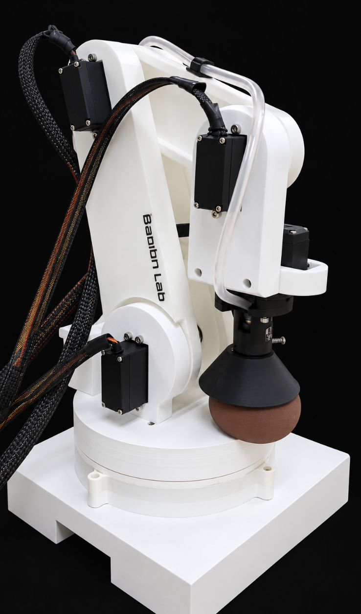
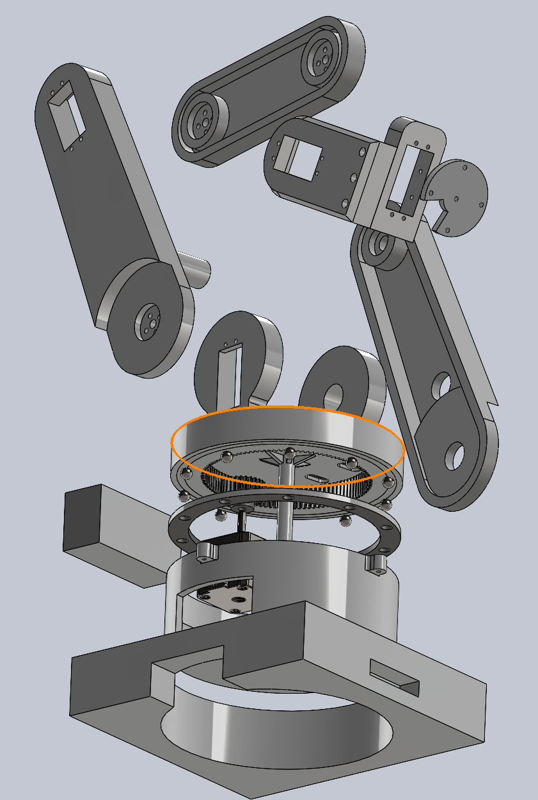
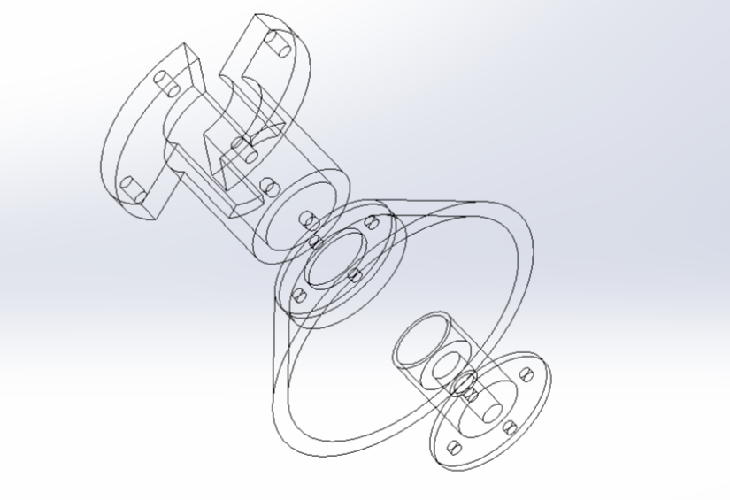
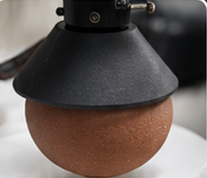
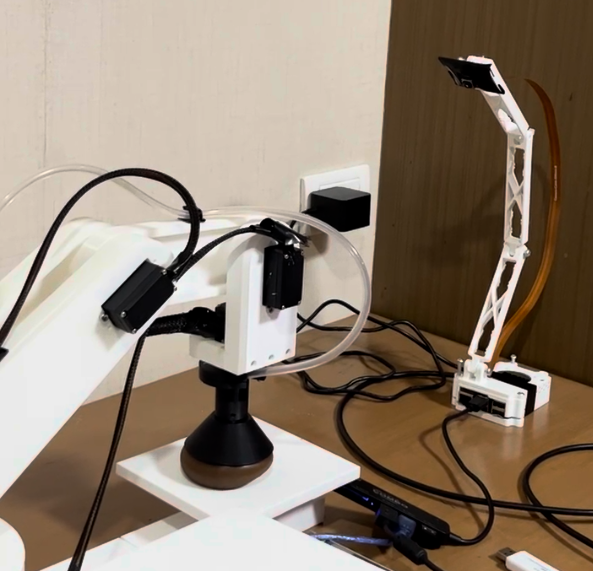

# 5DOF Robotic Arm with Flexible Spherical Gripper

### Design and Building of Robotic Arm with Flexible Spherical Gripper

**Senior Engineering Project | September 2026**

**Assumption University of Thailand**  
Vincent Mary School of Engineering, Science and Technology

**Fields:** Robotics | Mechatronics | Artificial Intelligence | Embedded Systems | Computer Vision

  

  <em>Figure 1. Completed 5DOF robotic arm with flexible spherical gripper.</em>

---

## 1. Project Overview

This project presents the design and development of a five-degree-of-freedom (5DOF) robotic manipulator equipped with a flexible spherical gripper for pick-and-place applications.

The system combines mechanical design, embedded control, robotic kinematics, computer vision, and adaptive gripping technology.

A YOLO11-based object detection system identifies objects within a designated collection area. Homography-based coordinate transformation is used to convert detected image positions into physical workspace coordinates.

The robotic manipulator is constructed primarily from 3D-printed PLA components, providing a low-cost platform for robotic manipulation research and development.

## 2. Project Objectives

- Design and fabricate a 5DOF robotic manipulator.
- Develop an adaptive spherical gripper using granular jamming.
- Implement forward and inverse kinematics.
- Integrate ESP32-based motor control.
- Apply YOLO11 for object detection.
- Convert pixel coordinates into physical coordinates using homography.
- Evaluate mechanical strength using SolidWorks Simulation.
- Investigate automated object handling and relocation.

## 3. System Architecture

The project consists of four major subsystems:

1. **Robotic Manipulator:** A 5DOF articulated arm with a 3D-printed PLA structure.
2. **Embedded Control:** ESP32-based actuator coordination using servo and stepper motor control.
3. **Flexible Gripper:** A granular-jamming end effector with pneumatic vacuum control.
4. **Computer Vision:** YOLO11 detection and homography-based workspace coordinate mapping on a Raspberry Pi 5.

### System Workflow

1. Capture images from the camera.
2. Detect objects using YOLO11.
3. Extract object coordinates from bounding boxes.
4. Transform image coordinates using planar homography.
5. Calculate the required robotic joint positions.
6. Operate the robotic arm and flexible gripper.

**Integration status:** The project demonstrated the individual robotic and vision subsystems, but reliable fully automatic coordinate communication and end-to-end operation remained a limitation.

## 4. Robotic Arm Mechanical Design

The robotic arm consists of five revolute joints:

| Joint | Function |
|---|---|
| Joint 1 | Base rotation |
| Joint 2 | Shoulder movement |
| Joint 3 | Elbow movement |
| Joint 4 | Wrist pitch |
| Joint 5 | End-effector rotation |

### Robot Geometry

| Parameter | Length |
|---|---|
| Physical base height | 88.5 mm |
| Kinematic base offset | 55.37 mm |
| Lower arm link | 150 mm |
| Upper arm link | 120 mm |
| Wrist/end-effector link | 80 mm |

The maximum theoretical planar reach is:

**Rmax = 150 + 120 + 80 = 350 mm**

The usable workspace is smaller because of joint limitations, structural geometry, and mechanical constraints.

### Mechanical Construction

- SolidWorks mechanical modelling
- PLA components manufactured using FDM 3D printing
- NEMA 17 stepper-driven base
- 4:1 base gear reduction
- MG996R servo actuation
- Bearing-supported rotational structure

### Robotic Arm Exploded View

  

  <em>Figure 2. Exploded view of the robotic arm mechanical assembly.</em>

The exploded view illustrates the mechanical components and assembly configuration of the robotic manipulator.

## 5. Embedded Control System

The robotic arm uses the following control hardware:

| Component | Function |
|---|---|
| ESP32 | Central robotic controller |
| PCA9685 | Servo PWM control |
| MG996R | Robotic joint actuation |
| NEMA 17 | Base rotation |
| A4988 | Stepper motor driver |
| Blynk IoT | Remote manual control |
| Raspberry Pi 5 | Computer vision processing |

The embedded subsystem manages motor commands and robotic joint positioning.

## 6. Robotic Kinematics

Forward and inverse kinematics are used to describe the relationship between robotic joint angles and end-effector position.

The Denavit-Hartenberg method defines the transformations between consecutive robot links.

### Forward Kinematics

The complete homogeneous transformation is:

$$
T_0^5 = A_1 A_2 A_3 A_4 A_5
$$

### Inverse Kinematics

For a desired position (x, y, z):

**Base angle:**

$$
\theta_1 = \operatorname{atan2}(y,x)
$$

**Radial distance:**

$$
r = \sqrt{x^2+y^2}
$$

The wrist-center position is calculated by subtracting the end-effector offset based on the required tool pitch.

The shoulder and elbow angles are then determined using geometric inverse kinematics and the cosine rule.

Detailed equations and coordinate-frame assignments are presented in the senior project report.

## 7. Flexible Spherical Gripper

The end effector uses the granular-jamming principle to grip objects of different geometries.

A flexible membrane filled with granular material conforms to an object's surface. When vacuum is applied, the granular material becomes more rigid through jamming, improving contact and holding force.

### Gripper Design and Fabrication

| Mechanical Exploded View | Fabricated Spherical Gripper |
|:---:|:---:|
|  |  |
| Figure 3. Gripper mechanical assembly | Figure 4. Fabricated flexible spherical gripper |

### Gripper Redesign

The initial design used a syringe-based vacuum system and a modular latex gripper head.

Challenges included:

- Vacuum leakage between printed parts
- Limited suction capacity
- Insufficient membrane durability
- Inconsistent contact with objects

The redesigned mechanism introduced:

- An electrically driven air pump
- A pneumatic solenoid valve
- A simplified gripper housing
- A conical gripping head
- A more durable silicone membrane

The redesigned gripper demonstrated the ability to handle objects weighing approximately **150–200 g** during testing.

## 8. Computer Vision and Object Detection

The system uses a trained YOLO11 object detection model.

The dataset includes five object classes:

- Bottles
- Tin cans
- Dice
- Balls
- Other designated training objects

### Homography-Based Coordinate Transformation

A planar homography matrix transforms image coordinates into coordinates on the physical collection surface.

The workflow consists of:

1. Selecting four reference points around the collection area.
2. Calculating the homography transformation.
3. Detecting objects with YOLO11.
4. Extracting the bottom-center location of each bounding box.
5. Converting pixel positions into planar workspace coordinates.
6. Averaging coordinates to reduce detection fluctuations.

### Raspberry Pi 5 Optimization

The image-processing pipeline was adapted for CPU-based execution on Raspberry Pi 5.

Reducing the inference resolution from 640 × 640 to 320 × 320 improved the reported processing speed from approximately one frame every three seconds to around five frames per second.

The trade-off was reduced image detail, which can affect the detection of smaller objects.

## 9. Structural Analysis

Finite Element Analysis (FEA) was performed using SolidWorks Simulation.

### Simulation Conditions

- Material: PLA
- Assumed yield strength: 30 MPa
- Gravity: 9.81 m/s²
- Applied end-effector force: approximately 5 N
- Analysis type: Linear static
- Boundary condition: Fixed robot base
- Contact condition: Bonded structural interfaces

### Simulation Results

| Parameter | Original Design | Redesigned Design |
|---|---|---|
| Maximum von Mises stress | 6.911 MPa | 6.284 MPa |
| Factor of safety | 4.34 | 4.77 |

**Key finding:** The redesigned structure achieved approximately a 9.1% reduction in maximum simulated von Mises stress.

These results represent a theoretical structural assessment under specified assumptions, not experimentally verified failure limits.

## 10. Results and Discussion

### Experimental Setup

  

  <em>Figure 5. Robotic manipulator and computer vision experimental setup.</em>

The experimental setup integrates the robotic manipulator, flexible spherical gripper, external camera system, and embedded control hardware for robotic manipulation and object localization testing.

### Project Outcomes

The project demonstrated several important outcomes:

- Development of a functional 5DOF mechanical robotic structure
- Improved structural performance in SolidWorks simulation
- Successful redesign of the flexible spherical gripper
- Object gripping within the reported 150–200 g range
- YOLO11 object detection on Raspberry Pi 5
- Homography-based planar coordinate transformation
- Improved embedded vision inference performance

### Performance Summary

| Performance Parameter | Result |
|---|---|
| Degrees of freedom | 5 DOF |
| Theoretical maximum reach | 350 mm |
| Tested gripper handling range | 150–200 g |
| Base gear reduction | 4:1 |
| Redesigned maximum simulated stress | 6.284 MPa |
| Redesigned simulated factor of safety | 4.77 |
| Simulated stress reduction | Approximately 9.1% |
| Optimized vision inference speed | Approximately 5 FPS |

### Known Limitations

- Fully automatic robot–vision communication was not yet reliable.
- Computer vision performance was sensitive to illumination, reflections, and object obstruction.
- The actual operating workspace was limited by mechanical joint constraints.
- The structural analysis simplified joint compliance, backlash, and dynamic loads.

## 11. Future Improvements

- Improve robot–vision communication.
- Develop more reliable automated pick-and-place operation.
- Improve camera calibration and coordinate accuracy.
- Optimize object detection performance.
- Improve robotic positioning and mechanical stability.
- Perform additional physical load and repeatability tests.

## 12. Tools and Technologies

| Category | Technologies |
|---|---|
| Mechanical Design | SolidWorks |
| Structural Analysis | SolidWorks Simulation |
| Manufacturing | FDM 3D Printing, PLA |
| Embedded Systems | ESP32, PCA9685 |
| Actuation | NEMA 17, MG996R, A4988 |
| Computer Vision | YOLO11, Homography |
| Computing Platform | Raspberry Pi 5 |
| IoT Control | Blynk IoT |
| Robotics | Forward and Inverse Kinematics |
| Gripping Technology | Granular Jamming, Pneumatics |

## 13. Project Documentation

This repository is being organized to include the following project materials:

- [x] Project overview and technical specifications
- [x] Completed robotic arm photographs
- [x] Mechanical exploded views
- [x] Flexible spherical gripper photographs
- [x] Experimental setup photographs
- [ ] Embedded control source code
- [ ] Computer vision implementation
- [ ] SolidWorks CAD designs
- [ ] Mechanical analysis files
- [ ] Electrical connection diagrams
- [ ] Demonstration videos
- [ ] Senior engineering project report

### Repository Contents

| Directory | Description |
|---|---|
| [images/](images/) | Project photographs and mechanical design illustrations |
| README.md | Project overview and technical documentation |

Additional directories will be included as the project files are published.

## 14. Project Team

### Project Authors

- Thu Ta Oo
- Thu Ya Win Hein
- Swan Htet Aung
- Keerapat Suppatarakasem
- Puvanai Vibultaveesup

### Project Advisors

- Dr. Jiradech Kongthon
- Dr. Jerapong Rojanarowan

### Institution

**Assumption University of Thailand**

Vincent Mary School of Engineering, Science and Technology

---

## 15. Project Status

Senior engineering project documented in September 2026.

Further source-code publication, testing documentation, and demonstration materials will be added to this repository.

---

  <em>Developed as part of the Bachelor of Engineering program at Assumption University of Thailand.</em>

